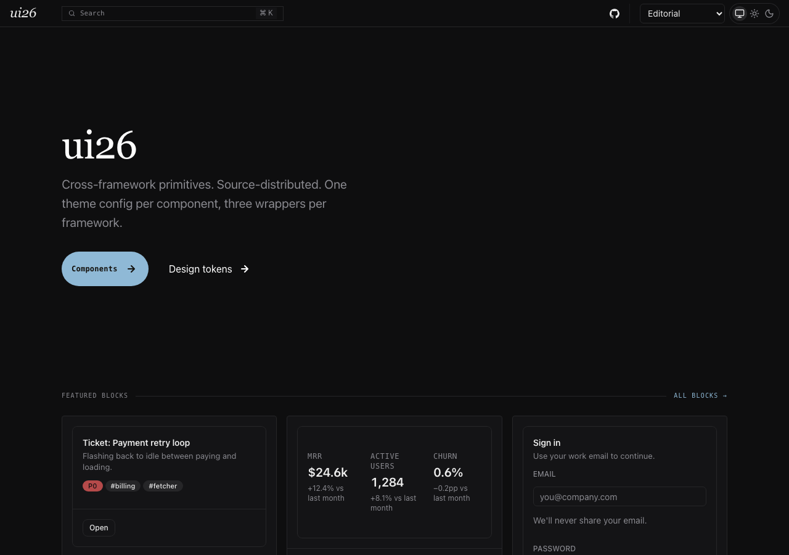

# ui26

Cross-framework UI primitives for React, Svelte, and Astro. Source-distributed — install via `npx shadcn add`, own the code.



## Install

```sh
npx shadcn add https://winston-ui26.netlify.app/r/button.json
```

Replace `button` with any component name. [Full docs →](https://winston-ui26.netlify.app)

## Dev

```sh
pnpm install
pnpm dev
```

## License

MIT
